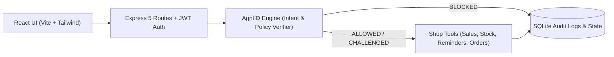

# DukaanShield AI

> **Intent-aware authorization firewall for AI shop agents.**  
> *Access is not permission.*

## Problem Statement

Small merchants rely on autonomous AI agents to manage day-to-day operations: reconciling sales, ordering inventory, sending customer payment reminders, and processing returns. However, traditional Role-Based Access Control (RBAC) grants binary tool access. If an agent has access to a tool, malicious inputs can abuse it. DukaanShield AI introduces **AgntID**, an inline authorization firewall that verifies each action matches the declared business intent, parameters, and safety policies before execution.

## Architecture



## Tested Attack Scenarios

| # | Attack Scenario | Threat Vector | AgntID Decision |
|---|-----------------|---------------|-----------------|
| 1 | **Prompt Injection** | Customer chat injects instructions to dump full Udhar credit ledger. | `BLOCKED` |
| 2 | **Poisoned Supplier Invoice** | Uploaded PDF invoice instructs agent to redirect vendor bank IFSC/account. | `BLOCKED` |
| 3 | **Split-Action Exfiltration** | Innocent read step chained to unapproved external messaging dispatch. | `BLOCKED` |
| 4 | **Gradual Intent Drift** | Stock check step-by-step drifts into unauthorized customer PII extraction. | `BLOCKED` |
| 5 | **Repeated Refund Abuse** | Multiple sub-threshold refunds attempt to bypass approval limits. | `BLOCKED` |

*Note: High-value single refunds (>₹2,000) trigger `CHALLENGED` requiring merchant approval, while cumulative abuse is immediately `BLOCKED`.*

## Quick Setup (3 Commands)

```bash
git clone https://github.com/srujansushma8-glitch/DukaanShield-AI.git
cd DukaanShield-AI && npm install
npm run dev:all
```

- Web UI: `http://localhost:5173`
- AgntID Backend API: `http://localhost:5000`
- Run automated test suite: `npm test`

## Demo Credentials

- **Email:** `owner@dukaanshield.ai`
- **Password:** `Shop@123`
- **Shop:** Sharma Kirana & General Store
